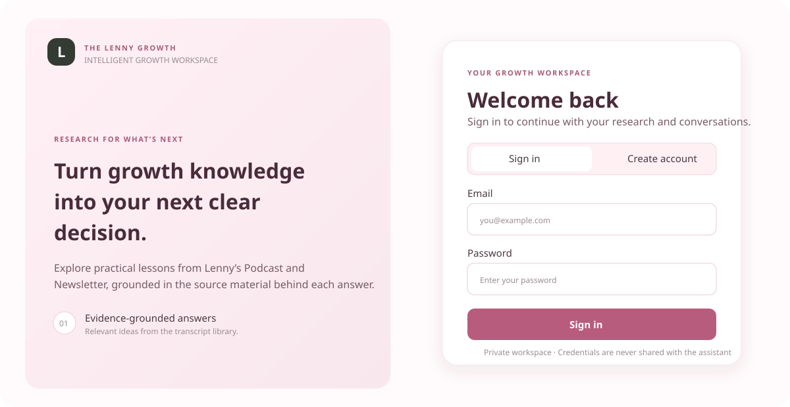
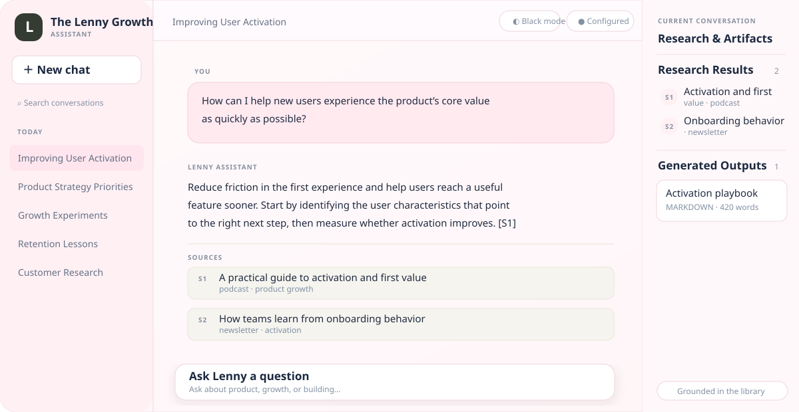
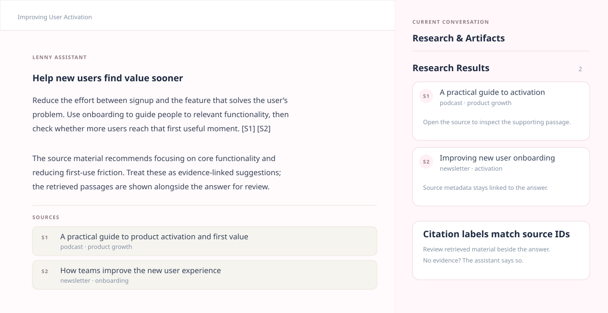
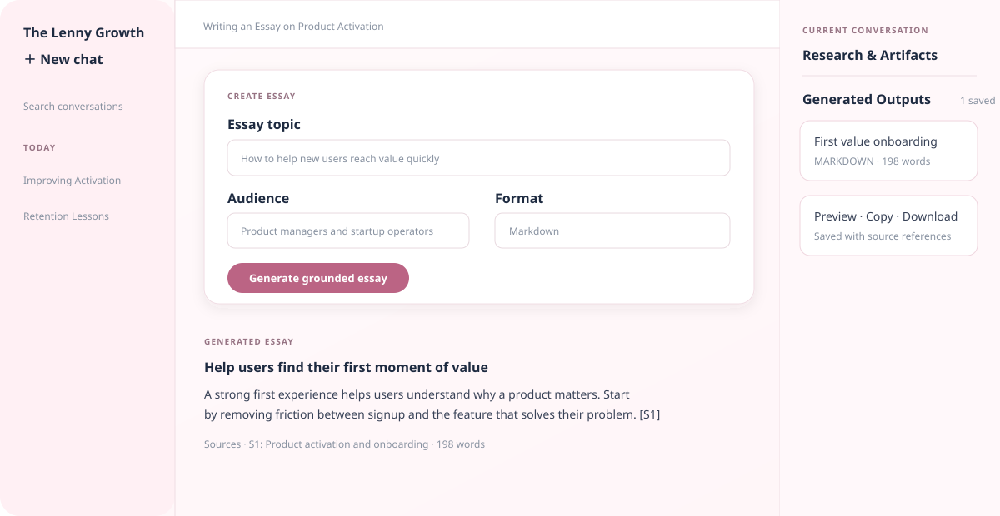
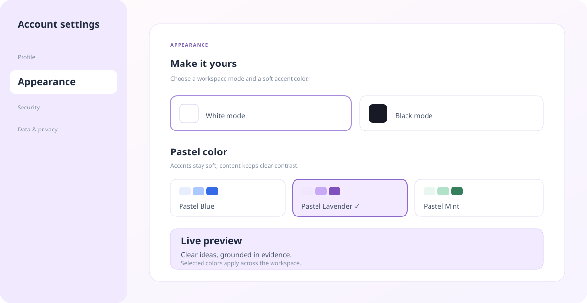
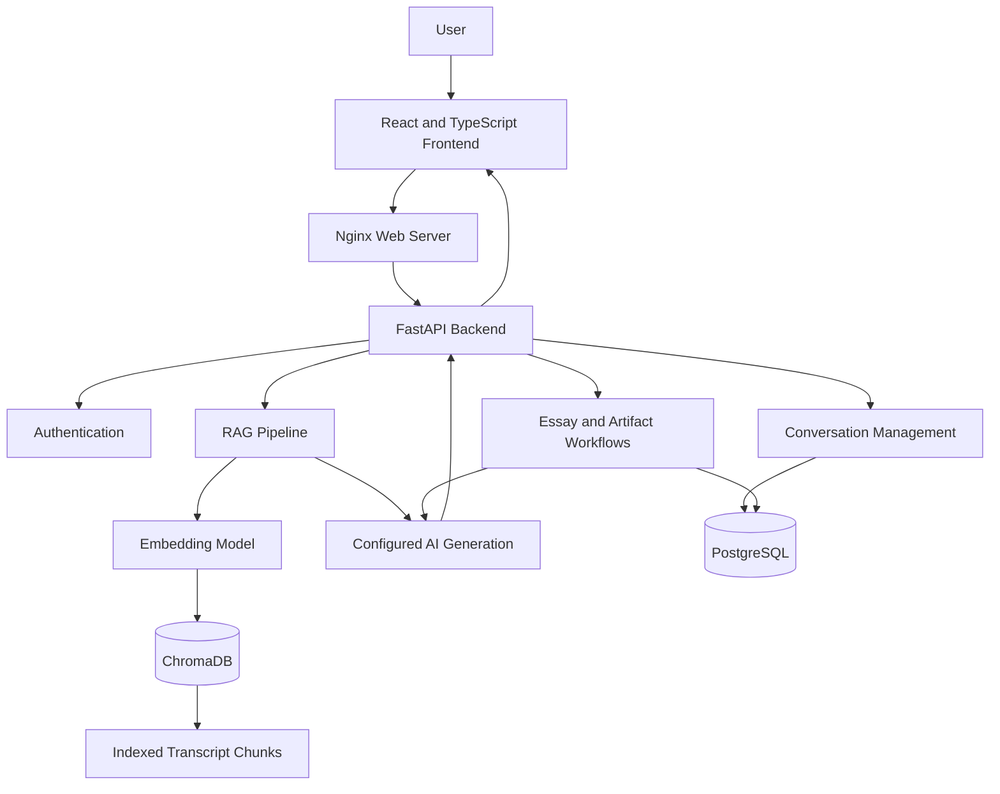

# The Lenny Growth Assistant

### Turn growth knowledge into better product decisions.

The Lenny Growth Assistant is an AI-powered research and writing workspace that helps product managers, startup founders, and growth teams explore insights from Lenny's podcast and newsletter transcripts.

By combining **Retrieval-Augmented Generation (RAG), conversational AI, semantic search, and document generation**, the application transforms a collection of long-form content into a searchable knowledge base for product research and growth strategy.

---

## Overview

Product and growth teams regularly need to research topics such as user activation, customer retention, product-market fit, experimentation, and product strategy.

However, valuable insights are often scattered across lengthy podcast episodes and newsletter articles.

The Lenny Growth Assistant provides a unified workspace where users can ask questions, retrieve relevant source material, explore AI-generated answers, and create research documents.

### The core workflow

1. Ask a question about product management, growth, or startup strategy.
2. Retrieve relevant passages from the indexed transcript collection.
3. Generate a response using the configured language model and retrieved context.
4. Inspect available source references.
5. Create essays and documents using the dedicated writing workflows.
6. Return to saved conversations and generated outputs.

The goal is to make research more accessible while keeping answers connected to their source material.

---

## Application Screenshots

### 1. Login and Authentication

The login interface provides access to the research workspace.



### 2. Main Chat Interface

Ask questions about product management, startup growth, user activation, and retention through the conversational interface.



### 3. Research Results and Source References

The research panel displays retrieved transcript sources alongside the conversation, making it easier to inspect the supporting material.



### 4. Essay Generation

The essay workflow supports creating structured, long-form content from a research topic.



### 5. Generated Content and Saved Outputs

The application provides a dedicated area for viewing generated outputs associated with a conversation.


### 6. Appearance Settings

Users can customize the workspace appearance using the available theme and accent-color settings.



---

## Key Features

### AI-Powered Research Chat

Ask natural-language questions about:

- Product management and feature prioritization
- User activation and onboarding
- Customer retention and churn
- Startup growth strategies
- Product-led growth
- Product-market fit and experimentation

### Retrieval-Augmented Generation

The RAG pipeline retrieves semantically relevant transcript passages and provides them as context for response generation.

This connects the question-answering workflow to the indexed knowledge base rather than relying solely on the language model's general knowledge.

### Source-Aware Answers

Retrieved sources are displayed when available, helping users inspect the material associated with an answer.

The quality of citations depends on the retrieval metadata and the correctness of the complete generation workflow.

### Essay Generation

The application includes a dedicated essay-generation workflow intended for structured, long-form writing. The assignment-specific Ship 30 for 30 skill targets approximately 1,250 words, with a compelling hook, clear sections, skimmable formatting, grounded claims, and a practical takeaway.

### Artifact Generation and Viewer

The artifact workflow supports Markdown documents and supported HTML/CSS content. The Artifact Viewer provides a dedicated area to inspect generated content alongside the conversation.

Generated HTML should be treated as untrusted content and rendered with appropriate isolation and sanitization controls.

### Conversation Management

Users can create separate conversations for different research topics and return to their previous discussions.

Conversation titles, messages, timestamps, and other supported records are persisted through the application's database workflows.

### Local AI Integration

Ollama provides a local inference option for supported model workflows, allowing the application to run without requiring a paid cloud inference request for every interaction.

### Containerized Deployment

Docker Compose coordinates the configured application services, database startup, migrations, and health checks.

The repository includes startup and shutdown scripts for a simpler local development experience.

---

## System Architecture

The application separates the user interface, API, retrieval pipeline, model integration, and persistence layer.



### Request lifecycle

**Step 1 — User request:** The frontend sends a question to the FastAPI backend.

**Step 2 — Retrieval:** The backend searches the ChromaDB collection for relevant transcript chunks.

**Step 3 — Context preparation:** Retrieved passages are assembled as context for the configured generation workflow.

**Step 4 — AI generation:** The configured model or agent integration generates the response.

**Step 5 — Response delivery:** The application returns the answer and available source references to the frontend.

**Step 6 — Persistence:** Supported conversation and generated-output records are stored in PostgreSQL.

The diagram describes the intended architecture; individual workflows should be verified against the current implementation.

---

## Technology Stack

| Component | Technologies |
|---|---|
| Frontend | React, TypeScript, Vite |
| Web server | Nginx |
| Backend | Python, FastAPI |
| Application database | PostgreSQL |
| Database access | SQLAlchemy |
| Database migrations | Alembic |
| Vector database | ChromaDB |
| Retrieval | Embeddings, semantic search, RAG |
| Local inference | Ollama |
| Agent integration | Pi Coding Agent integration |
| Containerization | Docker, Docker Compose |
| Backend testing | Pytest |
| Frontend testing | Configured frontend test suite |
| Version control | Git, GitHub |

---

## Getting Started

### Prerequisites

Install the following:

- Git
- Docker Desktop with Docker Compose
- Ollama

Python and Node.js are also useful when running tests or developing outside the containers.

Docker Desktop and Ollama should be running before you start the application.

### 1. Clone the repository

Open Git Bash and run:

```bash
git clone https://github.com/Harini-sri-r/The-Lenny-Growth-Assistant.git
cd The-Lenny-Growth-Assistant
```

### 2. Install the local AI models

Download the configured generation and embedding models:

```bash
ollama pull qwen2.5:3b
ollama pull nomic-embed-text:latest
```

Check the installed models:

```bash
ollama list
```

The generation model produces text responses. The embedding model supports semantic retrieval when it matches the application's embedding configuration.

### 3. Configure environment variables

Create a local environment file:

```bash
cp .env.example .env
```

Open `.env` and configure the required database credentials, ports, AI provider, model settings, and data paths.

**Important:** If you already have a PostgreSQL Docker volume, preserve the credentials used to initialize that database. Changing a password in `.env` alone does not change the password stored inside PostgreSQL.

Never commit `.env`, API keys, database passwords, or other secrets to GitHub.

### 4. Start the application

From the repository root, run the startup script.

**Git Bash:**

```bash
./start.sh
```

**Windows Command Prompt or PowerShell:**

```bat
start.bat
```

The startup scripts are designed to start the configured services, wait for database readiness, run migrations, and check service health.

Make sure the transcript data and ChromaDB index are available at the paths configured for your environment.

---

## Environment Configuration

The `.env.example` file is the reference for supported configuration variables.

| Variable | Purpose |
|---|---|
| `POSTGRES_DB` | PostgreSQL database name |
| `POSTGRES_USER` | PostgreSQL username |
| `POSTGRES_PASSWORD` | PostgreSQL password |
| `BACKEND_PORT` | Backend host port |
| `FRONTEND_PORT` | Frontend host port |
| `CHROMA_HOST_PATH` | Host path for persistent ChromaDB data |
| `CHROMA_PERSIST_DIRECTORY` | ChromaDB directory inside the container |
| `TRANSCRIPTS_PATH` | Transcript dataset location |
| `LLM_PROVIDER` | Configured language-model provider |
| `AGENT_FRAMEWORK` | Agent integration selection |
| `OLLAMA_BASE_URL` | Ollama API endpoint |
| `OLLAMA_MODEL` | Text-generation model |
| `OLLAMA_EMBEDDING_MODEL` | Embedding model |
| `RAG_COLLECTION_NAME` | ChromaDB collection name |

Use only variables supported by the actual project configuration. Review `.env.example` for the complete list and defaults.

---

## Local AI Setup

The example below configures Ollama running on the Windows host while the backend runs inside Docker.

```dotenv
LLM_PROVIDER=ollama
OLLAMA_BASE_URL=http://host.docker.internal:11434
OLLAMA_MODEL=qwen2.5:3b
OLLAMA_EMBEDDING_MODEL=nomic-embed-text:latest
```

`host.docker.internal` allows Docker Desktop containers to reach services running on the host.

To check Ollama connectivity from the backend container:

```bash
docker compose --env-file .env exec backend python -c "import urllib.request; print(urllib.request.urlopen('http://host.docker.internal:11434/api/tags', timeout=10).status)"
```

An HTTP status of `200` confirms that the Ollama tags endpoint is reachable. It does not prove that chat, essay, or artifact generation succeeds; test each workflow separately.

---

## Cloud Model Configuration

Cloud inference depends on the providers supported by the current implementation.

Before configuring a cloud model:

1. Confirm that its provider integration exists.
2. Set the supported provider and model identifiers.
3. Add the required API key to the local `.env`.
4. Restart the application services.
5. Test a real generation request and inspect the logs.

Do not assume automatic fallback between local and cloud models unless that behavior has been implemented and verified.

---

## Running the Application

### Application URLs

With the documented default local configuration:

| Service | URL |
|---|---|
| Frontend | http://localhost:5173 |
| Backend health | http://localhost:8001/health |
| Frontend API health | http://localhost:5173/api/v1/health |
| FastAPI documentation | http://localhost:8001/docs |

The backend and frontend ports can differ if configured in `.env`.

### Check service status

```bash
docker compose --env-file .env ps
```

### View logs

```bash
docker compose --env-file .env logs -f
```

### View backend logs

```bash
docker compose --env-file .env logs --tail=100 backend
```

### Validate Docker configuration

```bash
docker compose --env-file .env config --quiet
```

### Stop the application

**Git Bash:**

```bash
./stop.sh
```

**Windows:**

```bat
stop.bat
```

The stop scripts are intended to stop the application without deleting persistent database or vector-index data.

Avoid using `docker compose down -v` when you need to preserve existing PostgreSQL data.

---

## Testing

### Backend tests

From the repository root:

```bash
python -m pytest backend/tests -q
```

Run this command in the Python environment containing the project's test dependencies.

### Frontend tests

```bash
cd frontend
npm ci
npm test
```

### Frontend production build

```bash
npm run build
```

### Manual verification checklist

After startup, verify the following:

- [ ] Register or sign in.
- [ ] Create a new conversation and send a question.
- [ ] Confirm that the answer is generated successfully.
- [ ] Inspect retrieved sources and citation references.
- [ ] Check how unsupported questions are handled.
- [ ] Generate an essay and verify its structure and length.
- [ ] Generate an artifact and confirm that it renders in the viewer.
- [ ] Confirm generated outputs are saved.
- [ ] Refresh the application and check conversation persistence.
- [ ] Verify that separate conversations have independent histories.
- [ ] Inspect logs for provider errors, timeouts, and failed requests.

A passing health check confirms service availability, not complete AI functionality. Test real generation and persistence workflows before declaring them successful.

---

## Security and Data Handling

- Keep credentials and API keys in local environment configuration.
- Exclude `.env` and other secrets from version control.
- Enforce authentication and ownership checks for protected resources.
- Treat model-generated HTML and JavaScript as untrusted.
- Apply appropriate sanitization and isolation to artifact rendering.
- Avoid logging credentials, authentication tokens, or unnecessary sensitive content.
- Preserve persistent database and vector-index data during routine restarts.
- Respect the source dataset's license and redistribution restrictions.

Security controls should be described as implemented only when the relevant code and behavior have been verified.

---

## Troubleshooting

| Problem | Suggested action |
|---|---|
| Docker services fail to start | Check Docker Desktop and inspect Compose service logs. |
| PostgreSQL authentication fails | Verify credentials against the existing database volume. |
| Database migration fails | Inspect the migration and backend logs. |
| A port is already in use | Configure an available host port in `.env`. |
| Ollama is unavailable | Start Ollama and test connectivity from the backend container. |
| A model is missing | Run `ollama list` and pull the configured model. |
| Pi executable cannot be found | Verify that the configured executable is accessible inside the backend image. |
| Chat returns HTTP 503 | Inspect provider, agent, and timeout errors in backend logs. |
| The answer contains only retrieved passages | Investigate the generation prompt, provider integration, and model errors. |
| Essay generation fails | Test the essay endpoint and inspect backend logs. |
| Artifact generation fails | Check artifact creation, rendering, and persistence separately. |
| No relevant sources appear | Verify transcript ingestion, collection name, and ChromaDB data path. |

Do not delete PostgreSQL volumes or the ChromaDB index as a first troubleshooting step.

---

## Project Structure

```text
The-Lenny-Growth-Assistant/
├── backend/
│   ├── app/
│   └── tests/
├── frontend/
│   └── src/
├── docs/
│   ├── screenshots/
│   │   ├── login.png
│   │   ├── chat-interface.png
│   │   ├── research-results.png
│   │   ├── essay-generation.png
│   │   ├── artifact-generation.png
│   │   └── appearance-settings.png
│   ├── design.md
│   └── architecture.md
├── agent-transcripts/
├── scripts/
├── docker-compose.yml
├── start.sh
├── start.bat
├── stop.sh
├── stop.bat
├── .env.example
├── .gitignore
└── README.md
```

This is an illustrative overview of the main directories. Check the repository for the exact current structure and filenames.

---

## Future Improvements

Potential improvements include:

- Hybrid retrieval combining semantic and keyword search.
- Automated evaluation of answer grounding and citation accuracy.
- Stronger handling of unsupported questions.
- Improved response streaming and model error reporting.
- Better essay and artifact generation validation.
- Retrieval and generation performance monitoring.
- Regression tests for source attribution and answer quality.

These are possible future enhancements rather than claims about existing functionality.
