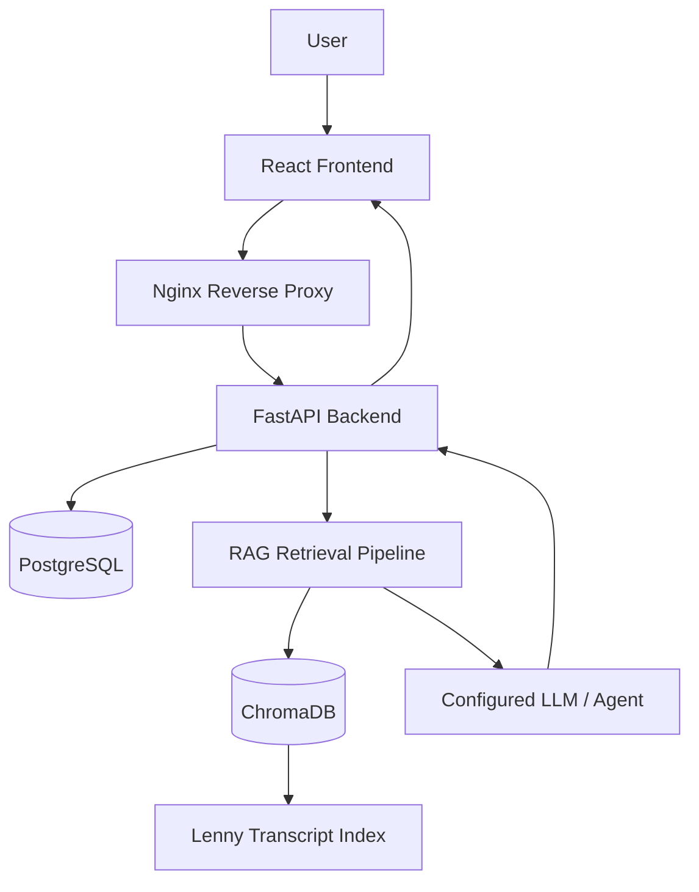

# The Lenny Growth Assistant

**An AI-powered research and writing assistant for product management and startup growth.**

The Lenny Growth Assistant helps product managers, startup founders, and growth teams discover insights from Lenny's newsletter and podcast transcripts. It combines retrieval-augmented generation (RAG), conversational AI, and document creation in a unified web application.

## Features

- **AI-powered chat:** Ask questions about product management, startup growth, user acquisition, retention, and product strategy.
- **Retrieval-Augmented Generation (RAG):** Retrieve relevant transcript passages to ground answers in source material.
- **Source references:** Display relevant source information when available.
- **Conversation management:** Maintain separate conversations with persistent storage.
- **Essay generation:** Create structured, long-form essays using a dedicated writing workflow.
- **Artifact generation:** Generate Markdown documents and supported HTML/CSS artifacts.
- **Artifact viewer:** Preview generated content within the application.
- **User authentication:** Account registration, login, and session-based access control.
- **Local AI support:** Integrate with Ollama for local model inference.
- **Containerized deployment:** Run the application services through Docker Compose with a single command.

## Technology Stack

| Component | Technologies |
|---|---|
| Frontend | React, TypeScript, Vite |
| Web server | Nginx |
| Backend | Python, FastAPI |
| Database | PostgreSQL, SQLAlchemy, Alembic |
| Vector database | ChromaDB |
| AI and retrieval | Embeddings, RAG, Ollama, Pi Coding Agent integration |
| Containerization | Docker, Docker Compose |
| Testing | Pytest, frontend tests |

## Architecture Overview



### Request workflow

1. The user submits a question through the frontend.
2. FastAPI processes the request and retrieves relevant transcript passages.
3. ChromaDB provides semantically relevant content from the indexed transcript collection.
4. The configured AI model generates a response using the retrieved context.
5. Source references are returned when available.
6. Conversations and generated outputs are stored in PostgreSQL.

## Installation and Setup

### Prerequisites

Install the following:

- [Git](https://git-scm.com/downloads)
- [Docker Desktop](https://www.docker.com/products/docker-desktop/)
- [Ollama](https://ollama.com/download)

Docker Desktop must be running before you start the application.

### 1. Download the Project

Clone the GitHub repository:

```bash
git clone https://github.com/Harini-sri-r/The-Lenny-Growth-Assistant.git
cd The-Lenny-Growth-Assistant
```

### 2. Install the Ollama Models

Start Ollama and open a terminal. Download the required local models:

```bash
ollama pull qwen2.5:3b
ollama pull nomic-embed-text:latest
```

Verify the installed models:

```bash
ollama list
```

The generation model produces responses, while the embedding model supports semantic retrieval.

### 3. Configure Environment Variables

Create a local `.env` file from the provided example.

Git Bash:

```bash
cp .env.example .env
```

Open `.env` and configure the required database credentials, application ports, model settings, and data paths.

**Important:** If you are using an existing PostgreSQL Docker volume, preserve the credentials with which that database was initialized. Changing the password in `.env` alone does not change the password inside PostgreSQL.

Keep `.env` private and never commit API keys, database passwords, or other credentials.

### 4. Start the Entire Application

From the repository root in Git Bash, run:

```bash
./start.sh
```

On Windows Command Prompt or PowerShell, run:

```bat
start.bat
```

The startup script uses Docker Compose to build images when required, start the services, wait for database readiness, run migrations, and check service health.

Ensure the required transcript dataset and ChromaDB data are available at the configured paths. Follow the dataset's license terms.

## Access the Application

With the default local configuration:

| Service | URL |
|---|---|
| Frontend | http://localhost:5173 |
| Backend health | http://localhost:8001/health |
| Frontend API health | http://localhost:5173/api/v1/health |
| API documentation | http://localhost:8001/docs |

The backend host port can differ if configured in `.env`.

## Configuration

Application settings are managed through `.env`. Refer to `.env.example` for the complete list of supported variables.

| Variable | Description |
|---|---|
| `DATABASE_URL` | Application database connection configuration |
| `POSTGRES_DB` | PostgreSQL database name |
| `POSTGRES_USER` | PostgreSQL username |
| `POSTGRES_PASSWORD` | PostgreSQL password |
| `BACKEND_PORT` | Backend host port |
| `FRONTEND_PORT` | Frontend host port |
| `CHROMA_HOST_PATH` | Host directory mounted for ChromaDB persistence |
| `CHROMA_PERSIST_DIRECTORY` | ChromaDB directory inside the backend container |
| `TRANSCRIPTS_PATH` | Transcript dataset location |
| `LLM_PROVIDER` | Selected LLM provider |
| `AGENT_FRAMEWORK` | Selected agent integration |
| `OLLAMA_BASE_URL` | Ollama endpoint |
| `OLLAMA_MODEL` | Local generation model |
| `OLLAMA_EMBEDDING_MODEL` | Embedding model |
| `RAG_COLLECTION_NAME` | ChromaDB collection name |

Configure only providers supported by the current implementation.

## Local and Cloud Model Configuration

### Local model with Ollama

The application can be configured to use Ollama for local inference.

Example settings for Docker:

```dotenv
LLM_PROVIDER=ollama
OLLAMA_BASE_URL=http://host.docker.internal:11434
OLLAMA_MODEL=qwen2.5:3b
OLLAMA_EMBEDDING_MODEL=nomic-embed-text:latest
```

The `host.docker.internal` hostname allows a container to reach Ollama running on the Windows host.

Check that Ollama is accessible from the backend container:

```bash
docker compose --env-file .env exec backend python -c "import urllib.request; print(urllib.request.urlopen('http://host.docker.internal:11434/api/tags', timeout=10).status)"
```

A successful connectivity check does not guarantee that chat or document generation works; test those workflows separately.

### Cloud models

Cloud model usage depends on the providers and routing supported by the current implementation.

To configure a cloud provider:

1. Verify that its integration is implemented.
2. Set the relevant provider and model variables.
3. Add the required API key to the local `.env`.
4. Restart the application.
5. Send a real request and verify the response and backend logs.

Never commit credentials or include them in screenshots or recordings. Automatic fallback between providers should not be assumed unless it has been tested.

## Running and Managing the Application

### Stop the application

Git Bash:

```bash
./stop.sh
```

Windows:

```bat
stop.bat
```

The stop scripts are intended to stop the project services without deleting persistent database or vector-index data.

### Check service status

```bash
docker compose --env-file .env ps
```

### View all logs

```bash
docker compose --env-file .env logs -f
```

### View backend logs

```bash
docker compose --env-file .env logs --tail=100 backend
```

### Validate the Docker configuration

```bash
docker compose --env-file .env config --quiet
```

## Testing

### Backend tests

From the repository root:

```bash
python -m pytest backend/tests -q
```

### Frontend tests

```bash
cd frontend
npm ci
npm test
```

### Frontend production build

```bash
npm run build
```

### Manual verification

After startup, verify the following:

1. Register or sign in.
2. Ask a question and inspect the answer and its source references.
3. Generate an essay and confirm the result is saved.
4. Generate an artifact and check its preview.
5. Refresh the application and verify that saved conversations and outputs persist.
6. Inspect backend logs for model errors, timeouts, or failed requests.

Health checks confirm service availability but do not guarantee successful AI generation.

## Troubleshooting

| Issue | Solution |
|---|---|
| Docker services do not start | Check Docker Desktop and inspect Compose service status and logs. |
| PostgreSQL authentication fails | Verify the credentials used to initialize the existing database volume. |
| Database migration fails | Inspect migration logs and resolve the reported connection or schema error. |
| Port is already in use | Configure an available host port in `.env`. |
| Ollama is unavailable | Start Ollama and check connectivity from the backend container. |
| Pi executable cannot be found | Verify the Pi executable path and its availability inside the backend image. |
| Chat returns HTTP 503 | Inspect backend logs for provider, agent, or timeout errors. |
| Essay or artifact generation fails | Check the selected provider, generation endpoint, retrieved context, and backend logs. |
| No relevant sources are retrieved | Verify the transcript index, collection name, and configured ChromaDB path. |

Do not delete the PostgreSQL volume or ChromaDB index as a troubleshooting shortcut.

## Security and Data Handling

- Keep API keys and passwords in local environment configuration.
- Use server-side authentication and ownership checks for protected resources.
- Treat generated HTML as untrusted and apply the sanitization or isolation controls implemented by the application.
- Preserve PostgreSQL and ChromaDB data during routine restarts.
- Respect the transcript dataset's license and avoid redistributing restricted source material.

## Project Documentation

The repository's supporting documentation should cover:

- Product requirements and discovery brief
- UI/UX design decisions
- System architecture and API design
- Sanitized agent transcripts and implementation decisions
- Automated tests and manual UI verification

Refer to the documentation directories for the actual files available in the repository.

## Project Status

The project includes the full-stack application, Docker Compose configuration, PostgreSQL persistence, semantic transcript retrieval, and AI-provider integration.

End-to-end chat, citation quality, essay generation, and artifact generation should be considered verified only after successful tests in the running environment. Known limitations should be documented clearly.

## Repository

[The Lenny Growth Assistant on GitHub](https://github.com/Harini-sri-r/The-Lenny-Growth-Assistant)

## License

See the repository's `LICENSE` file for software licensing terms. The transcript dataset may have separate licensing requirements.
