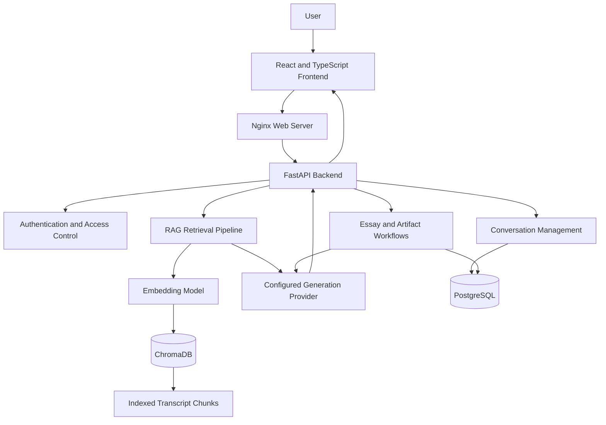

# The Lenny Growth Assistant

**An AI-powered research and writing workspace for product management, startup growth, and product strategy.**

[](https://www.python.org/)
[](https://fastapi.tiangolo.com/)
[](https://react.dev/)
[](https://www.typescriptlang.org/)
[](https://www.docker.com/)
[](https://ollama.com/)

The Lenny Growth Assistant transforms a collection of podcast and newsletter transcripts into a searchable knowledge workspace. It combines retrieval-augmented generation (RAG), conversational AI, persistent conversations, long-form writing, and document artifacts in one application.

Instead of manually searching through hours of interviews, users can ask focused questions, explore relevant source passages, develop actionable growth strategies, and create reusable documents.

**Core principle:** Ground answers in retrieved source material, preserve references where available, and distinguish supported information from recommendations.

---

## Table of Contents

- [Why This Project?](#why-this-project)
- [Key Features](#key-features)
- [Application Preview](#application-preview)
- [System Architecture](#system-architecture)
- [Technology Stack](#technology-stack)
- [Getting Started](#getting-started)
- [Environment Configuration](#environment-configuration)
- [Local and Cloud AI](#local-and-cloud-ai)
- [Using the Application](#using-the-application)
- [Testing and Verification](#testing-and-verification)
- [Troubleshooting](#troubleshooting)
- [Security and Data Handling](#security-and-data-handling)
- [Project Structure](#project-structure)
- [Engineering Documentation](#engineering-documentation)
- [Current Status and Limitations](#current-status-and-limitations)
- [Future Improvements](#future-improvements)
- [License and Attribution](#license-and-attribution)

---

## Why This Project?

Product managers and startup teams often need to research activation, retention, acquisition, pricing, product-led growth, and product strategy. Valuable insights can be scattered across long-form interviews and newsletters.

A general-purpose chatbot may provide useful suggestions, but it may not identify the specific source behind a recommendation.

The Lenny Growth Assistant addresses this problem through a source-oriented research workflow:

- **Discover:** Search a transcript collection using natural-language questions.
- **Understand:** Retrieve relevant passages and use them as context for AI-generated answers.
- **Validate:** Inspect available source references instead of relying exclusively on unsupported claims.
- **Create:** Turn research into structured essays, Markdown documents, and supported HTML artifacts.
- **Continue:** Keep conversations and generated outputs organized for later use.

### Intended users

- Product managers and growth product managers
- Startup founders and early-stage teams
- Product marketing professionals
- Researchers exploring product strategy and growth frameworks

---

## Key Features

### 1. Grounded AI Conversations

Ask questions about product strategy, startup growth, user acquisition, activation, retention, and related topics.

The backend retrieves relevant transcript passages and supplies them to the configured language model as context.

### 2. Retrieval-Augmented Generation

The retrieval pipeline connects a semantic search index to the answer-generation workflow.

The intended flow is:

1. Receive a user question.
2. Convert the query into a retrieval representation.
3. Retrieve relevant transcript chunks from ChromaDB.
4. Supply the retrieved context to the configured generation workflow.
5. Return the answer with source references when available.

Retrieval quality and answer quality are evaluated separately. Finding a relevant passage does not, by itself, prove that the generated answer is correct.

### 3. Source-Aware Research

Relevant transcript passages can be presented alongside assistant responses, helping users inspect the material used to support an answer.

Source availability and citation correctness depend on the indexed metadata and the functioning of the complete generation and verification workflow.

### 4. Long-Form Essay Generation

A dedicated writing workflow supports structured, long-form content for topics related to product management and startup growth.

The intended output includes a strong introduction, organized sections, practical insights, and actionable takeaways.

### 5. Document and Artifact Creation

The application includes workflows for creating Markdown documents and supported HTML/CSS artifacts.

The Artifact Viewer provides an in-application space to inspect generated content without treating every artifact as an ordinary chat message.

### 6. Conversation Management and Persistence

PostgreSQL stores application data through SQLAlchemy, with database schema changes managed using Alembic migrations.

The application is designed to keep conversations and generated outputs available across sessions, subject to the configured authentication, ownership checks, and persistence workflows.

### 7. Local AI with Ollama

The local inference configuration uses Ollama, allowing supported model requests to run on the host machine instead of requiring a paid cloud inference service.

This is useful for development, privacy-conscious workflows, and demonstrations without per-request cloud model charges.

### 8. Containerized Application

Docker Compose coordinates the application services, database readiness, migrations, and startup process.

The repository includes startup and shutdown scripts to simplify running the application on Windows.

---

## Application Preview

The interface brings together three main areas:

- **Conversation workspace:** Ask questions and review assistant responses.
- **Research results:** Inspect retrieved source passages.
- **Artifacts workspace:** Access generated documents and supported artifacts.

Add screenshots of the actual running application here once the final workflows have been verified.

Suggested repository assets:

- `docs/screenshots/chat.png`
- `docs/screenshots/research-results.png`
- `docs/screenshots/artifact-viewer.png`

Use real screenshots from your application rather than mockups presented as working features.

---

## System Architecture

The application separates the user interface, API layer, retrieval infrastructure, model integration, and persistence.



### Architecture responsibilities

| Component | Responsibility |
|---|---|
| React and TypeScript | User interface, chat interactions, and research workspace |
| Nginx | Serves the frontend and supports the configured API routing |
| FastAPI | API endpoints, request processing, and application orchestration |
| ChromaDB | Semantic retrieval over indexed transcript chunks |
| Embedding model | Converts text into vectors for semantic search |
| Ollama | Local model inference when configured and available |
| PostgreSQL | Persistent application data |
| SQLAlchemy | Database access and object-relational mapping |
| Alembic | Database schema migrations |
| Docker Compose | Service orchestration and local deployment |

The diagram describes the intended application architecture. Exact execution paths and provider behavior should be confirmed against the current implementation.

---

## Technology Stack

| Layer | Technologies |
|---|---|
| Frontend | React, TypeScript, Vite |
| Web serving | Nginx |
| Backend | Python, FastAPI |
| Application database | PostgreSQL |
| ORM and migrations | SQLAlchemy, Alembic |
| Vector database | ChromaDB |
| AI inference | Ollama, configured agent integration |
| Retrieval | Embeddings, semantic search, RAG |
| Containerization | Docker, Docker Compose |
| Testing | Pytest, frontend test suite |
| Source control | Git, GitHub |

---

## Getting Started

### Prerequisites

Install the following tools before starting:

- Git
- Docker Desktop with Docker Compose
- Ollama
- Python and Node.js only if you intend to run the relevant development or test commands directly on the host

**Hardware note:** Model performance depends on available RAM, CPU, GPU, and the selected model. Smaller models can run on modest hardware but may produce slower or less reliable long-form answers.

### 1. Clone the repository

Open Git Bash or a terminal:

```bash
git clone https://github.com/Harini-sri-r/The-Lenny-Growth-Assistant.git
cd The-Lenny-Growth-Assistant
```

### 2. Download the required Ollama models

Make sure Ollama is installed and running.

```bash
ollama pull qwen2.5:3b
ollama pull nomic-embed-text:latest
```

Verify the installed models:

```bash
ollama list
```

The Qwen model is configured for text generation. The embedding model is used for semantic retrieval when the application's embedding configuration matches it.

### 3. Configure the environment

Create the local environment file from the example:

```bash
cp .env.example .env
```

Open `.env` and review the database credentials, application ports, model configuration, and data paths.

**Important:** Do not replace the credentials of an existing PostgreSQL database volume without coordinating the actual database credentials. Editing `.env` alone does not change a password already stored in PostgreSQL.

Keep `.env` private. Never commit API keys, database passwords, or other secrets.

### 4. Start the application

Ensure Docker Desktop and Ollama are running, then execute the startup script from the repository root.

**Git Bash**

```bash
./start.sh
```

**Windows Command Prompt or PowerShell**

```bat
start.bat
```

The launcher is intended to build or start the required containers, wait for database readiness, run migrations, and check service health.

The transcript data and ChromaDB index must also be present at the paths configured for your local environment. Follow the source dataset's license terms.

### 5. Open the application

With the documented default local configuration:

| Service | URL |
|---|---|
| Frontend | http://localhost:5173 |
| Backend health | http://localhost:8001/health |
| Frontend API health | http://localhost:5173/api/v1/health |
| API documentation | http://localhost:8001/docs |

These ports may differ if the environment configuration has been changed.

---

## Environment Configuration

The complete list of supported variables is defined in `.env.example`. Review that file before changing the configuration.

| Variable | Purpose |
|---|---|
| `DATABASE_URL` | Application database connection configuration, if supported by the current Compose setup |
| `POSTGRES_DB` | PostgreSQL database name |
| `POSTGRES_USER` | PostgreSQL username |
| `POSTGRES_PASSWORD` | PostgreSQL password |
| `BACKEND_PORT` | Backend host port |
| `FRONTEND_PORT` | Frontend host port |
| `CHROMA_HOST_PATH` | Host path used for persistent ChromaDB data |
| `CHROMA_PERSIST_DIRECTORY` | ChromaDB persistence directory inside the container |
| `TRANSCRIPTS_PATH` | Location of transcript data |
| `LLM_PROVIDER` | Configured language-model provider |
| `AGENT_FRAMEWORK` | Agent integration selection |
| `OLLAMA_BASE_URL` | Ollama API endpoint |
| `OLLAMA_MODEL` | Text-generation model |
| `OLLAMA_EMBEDDING_MODEL` | Embedding model |
| `RAG_COLLECTION_NAME` | ChromaDB collection name |

Variable names and defaults must match the current `.env.example` and application configuration. Do not add unsupported settings or assume every provider is interchangeable.

---

## Local and Cloud AI

### Local inference with Ollama

Example configuration for a backend running in Docker while Ollama runs on the Windows host:

```dotenv
LLM_PROVIDER=ollama
OLLAMA_BASE_URL=http://host.docker.internal:11434
OLLAMA_MODEL=qwen2.5:3b
OLLAMA_EMBEDDING_MODEL=nomic-embed-text:latest
```

Use only variable names supported by your current configuration.

The hostname `host.docker.internal` allows Docker Desktop containers to reach services on the host machine.

Check connectivity from the backend container:

```bash
docker compose --env-file .env exec backend python -c "import urllib.request; print(urllib.request.urlopen('http://host.docker.internal:11434/api/tags', timeout=10).status)"
```

An HTTP status of `200` confirms that the Ollama tags endpoint is reachable from the container. It does **not** guarantee successful chat, essay, or artifact generation.

Test each generation workflow separately.

### Cloud model configuration

Cloud inference is optional and depends on which providers are implemented in the current application.

Before enabling a cloud provider:

1. Verify that its provider integration is implemented.
2. Check the supported provider and model identifiers.
3. Add the required API key to the local `.env`.
4. Restart the relevant services.
5. Send a real request and inspect the resulting response and logs.

Do not assume that automatic fallback between local and cloud providers exists. Provider switching and fallback behavior should be documented only after verification.

---

## Using the Application

A typical research workflow is:

1. Register or sign in.
2. Start a new conversation.
3. Ask a question about product management, growth, or startup strategy.
4. Inspect the retrieved source passages and references.
5. Review the assistant's answer against the available evidence.
6. Generate an essay or document when the relevant workflow is available.
7. Open the artifact viewer to inspect supported generated content.
8. Return to the conversation to continue the research.

For reliable results, ask focused questions and verify important claims against their cited source material.

---

## Running and Managing the Application

### Stop the services

**Git Bash**

```bash
./stop.sh
```

**Windows**

```bat
stop.bat
```

These scripts are intended to stop the project services without deleting persistent database or vector-index data.

### Check service status

```bash
docker compose --env-file .env ps
```

### View logs

```bash
docker compose --env-file .env logs -f
```

Backend logs:

```bash
docker compose --env-file .env logs --tail=100 backend
```

### Validate the Compose configuration

```bash
docker compose --env-file .env config --quiet
```

A successful configuration check verifies Compose syntax and configuration resolution, not end-to-end application behavior.

---

## Testing and Verification

The project uses backend and frontend tests to help verify application behavior.

### Backend tests

From the repository root:

```bash
python -m pytest backend/tests -q
```

If the host environment does not have the required dependencies, use the project's configured Python environment or the documented container-based test command.

### Frontend tests

```bash
cd frontend
npm ci
npm test
```

### Frontend production build

From the `frontend` directory:

```bash
npm run build
```

### Manual end-to-end verification

After startup, verify each workflow:

- [ ] Register and sign in.
- [ ] Create separate conversations and verify their histories remain independent.
- [ ] Ask a question supported by the indexed transcript library.
- [ ] Confirm the assistant produces a complete answer rather than only returning retrieved excerpts.
- [ ] Check that displayed citations resolve to real retrieved sources.
- [ ] Ask an unsupported question and check that the system handles it appropriately.
- [ ] Generate an essay and confirm the output is complete and saved.
- [ ] Generate an artifact and confirm it renders correctly in the viewer.
- [ ] Refresh the application and verify that the expected conversations and outputs persist.
- [ ] Check logs for provider failures, timeouts, or database errors.

**Evaluation principle:** Health checks, passing unit tests, and successful model connectivity are useful signals, but they do not substitute for real end-to-end tests.

Only publish specific test counts, accuracy figures, or performance benchmarks after running the corresponding tests and retaining their results.

---

## Troubleshooting

| Problem | What to check |
|---|---|
| Docker services fail to start | Confirm Docker Desktop is running; inspect `docker compose ps` and service logs. |
| PostgreSQL authentication fails | Verify the actual credentials used to initialize the existing database volume. |
| Migrations fail | Inspect backend and migration logs for connection or schema errors. |
| A port is already in use | Change the appropriate host port in `.env` and restart the services. |
| Ollama is unavailable | Start Ollama and test connectivity from the backend container. |
| A model is missing | Run `ollama list` and pull the configured model if necessary. |
| The Pi executable cannot be found | Verify that the configured executable exists and is accessible inside the backend container. |
| Chat returns HTTP 503 | Inspect backend logs for provider, agent, or timeout errors. |
| Answers contain only retrieved passages | Inspect the generation endpoint, provider integration, and model error logs. |
| Essay or artifact generation fails | Test the specific generation workflow and inspect its backend errors. |
| No relevant sources are found | Verify transcript ingestion, the collection name, and the ChromaDB persistence path. |

Avoid deleting PostgreSQL volumes or the ChromaDB index as a first troubleshooting step. Preserve existing data while diagnosing configuration and connection problems.

---

## Security and Data Handling

Security is part of the application's design, not just its deployment configuration.

- Store credentials and API keys in local environment variables.
- Exclude `.env`, tokens, and other secrets from version control.
- Enforce authentication and resource-ownership checks for protected operations.
- Treat model-generated HTML and JavaScript as untrusted content.
- Use appropriate isolation and sanitization for artifact rendering.
- Avoid logging secrets, authentication tokens, or unnecessary sensitive user content.
- Preserve persistent data during normal restarts and upgrades.
- Follow the license conditions of the transcript source.

The presence of a security-related dependency or configuration does not establish that the entire application is secure. Validate the actual implementation before describing a control as complete.

---

## Project Structure

```text
The-Lenny-Growth-Assistant/
├── backend/
│   ├── app/                 # FastAPI application and core logic
│   └── tests/               # Backend tests
├── frontend/
│   ├── src/                 # React and TypeScript application
│   └── package.json         # Frontend dependencies and scripts
├── docs/                    # Architecture, design, and project documents
├── agent-transcripts/       # Sanitized implementation and debugging notes
├── scripts/                 # Project utility scripts
├── docker-compose.yml       # Multi-service application configuration
├── start.sh                 # Git Bash startup script
├── start.bat                # Windows startup script
├── stop.sh                  # Git Bash shutdown script
├── stop.bat                 # Windows shutdown script
├── .env.example             # Example configuration
├── .gitignore               # Excluded files and local configuration
└── README.md                # Project documentation
```

This tree describes the main expected layout. Refer to the repository for the complete list of modules and files.

---

## Engineering Documentation

The repository's supporting documentation should explain the product and how to operate, evaluate, and extend it.

| Document | Purpose |
|---|---|
| Product requirements / discovery brief | User problems, goals, scope, and assumptions |
| `docs/design.md` | Interface structure and design decisions |
| `docs/architecture.md` | System components, data flow, and architectural decisions |
| Test plan | Automated tests and manual verification steps |
| Agent transcripts | Sanitized implementation attempts, failures, and corrections |

Refer to the actual files present in the repository. Documentation should reflect the current implementation rather than intended future behavior.

---

## Current Status and Limitations

The repository brings together a full-stack application, containerized startup, PostgreSQL persistence, semantic transcript retrieval, and AI integration.

The key distinction is between **implemented components** and **verified end-to-end workflows**.

In particular, chat response synthesis, citation correctness, essay generation, artifact rendering, and saved-output persistence should be considered complete only when they have been tested successfully in the running application.

Known limitations and incomplete workflows should be recorded clearly so that developers and evaluators can reproduce and investigate them.

---

## Future Improvements

Potential areas for continued development include:

- Hybrid retrieval combining semantic search and keyword ranking.
- Stronger automated evaluation of grounded answers and citation correctness.
- Better handling of unsupported or ambiguous questions.
- Streaming responses and clearer model execution status.
- More robust validation and testing of essay and artifact generation.
- Improved observability for retrieval latency, model failures, and end-to-end request timing.
- Reproducible evaluation datasets and regression tests for answer quality.

These are improvement opportunities, not claims that the functionality is already implemented.

---

## Repository

**GitHub:** [The Lenny Growth Assistant](https://github.com/Harini-sri-r/The-Lenny-Growth-Assistant)

Contributions, bug reports, and suggestions for improving retrieval quality, reliability, and usability are welcome.

## License and Attribution

See the repository's `LICENSE` file for the software's licensing terms.

The transcript dataset may be governed by a separate license. Review its terms before redistribution or commercial use, and do not include restricted source material in application images or public releases unless permitted.
